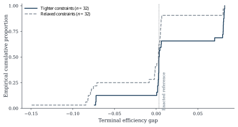
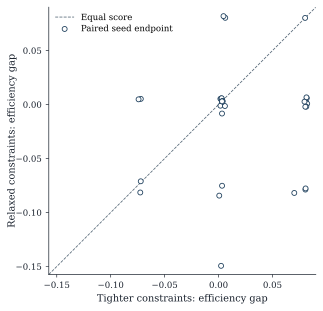
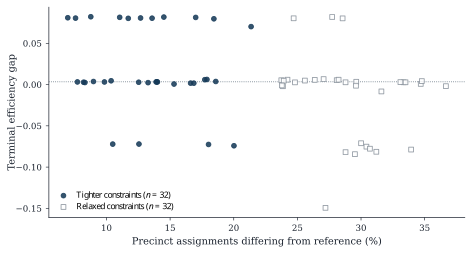

# The Phantom Baseline: Geographic Assumptions, Mixing Failures, and Constraint Sensitivity in Computational Redistricting

**A three-axis empirical audit and finite-horizon stress test**

*Research manuscript — Revised October 2026*  
*Status: Complete first scholarly draft; not yet externally peer reviewed.*  
*Data and code: [Gerrymandering-Project, research validation branch](https://github.com/DjokovicMan22/Gerrymandering-Project/tree/research/stages-1-3-validation).*

## Abstract

**An ensemble's apparent objectivity depends on how its baseline was constructed.** We investigate three independently testable vulnerabilities in computational redistricting—geographic topology, Markov-chain exploration, and constraint dependence—using source-matched Michigan precinct geography and counterfactual presidential-vote overlays. First, a previously used graph-repair procedure selected five artificial edges according to enacted congressional labels; the endpoint polygons were separated by approximately **42–280 km**. A district-blind proximity alternative retained reference connectivity with 13 candidate links and a maximum separation of **17.8 km**, although the resulting graph is not an independently certified legal adjacency model. Second, multi-chain diagnostics rejected the treatment of tested sampler outputs as converged ensemble draws: one ReCom condition yielded rank-normalized **R-hat 1.733** and bulk effective sample size **9.4**; a local reversible Metropolis–Hastings configuration yielded **R-hat 2.588**. Third, we implement a deliberately specified finite-horizon **stress test**, rather than infer a stationary law from failed convergence. Across 64 separately seeded 800-transition terminal maps, relaxing a composite set of geographic caps increased precinct reassignment by **15.61 percentage points** and reduced mean Democratic seats by **0.406** and mean efficiency gap by **0.03278**. The tighter-minus-relaxed efficiency-gap contrast had a paired-bootstrap 95% interval of **[+0.00975, +0.05631]**. We use these results to define an operational **baseline reliability protocol**: source-grounded topology, target-specific exploration evidence, and explicit assumption-sensitivity checks. The experiments identify how a reproducible computational baseline can depend materially on modeling decisions; they do not claim to establish the distribution of all lawful Michigan maps.

**Keywords:** redistricting; gerrymandering; Markov chain Monte Carlo; ReCom; graph topology; computational reproducibility; sampling convergence; geographic sensitivity; Michigan.

---

## 1. Introduction

**A redistricting ensemble does not become an objective baseline simply because it contains many maps.** What a histogram means depends on the graph used to define districts, the rules that determine admissibility, the transition kernel that explores them, and whether the resulting sample adequately approximates the claimed distribution. These are substantive modeling decisions. A stable-looking percentile does not independently establish that its counterfactual alternatives were neutral or legally plausible.

That distinction matters whenever ensemble rankings are treated as evidence of representational bias. A statement that an enacted plan is rare among simulated alternatives implicitly asserts that the simulation approximates a justified distribution over relevant maps. The apparent precision of a percentile cannot substitute for establishing this link. The redistricting literature already contains important work on recombination methods, simulation validation, and legally attentive state-level sampling (DeFord, Duchin, and Solomon 2021; McCartan et al. 2022; Kenny et al. 2023). We do not treat the field's existing methods as uniformly defective. We examine a concrete pipeline to identify the vulnerabilities that any claimed baseline should be able to survive.

The empirical analysis is organized around three **failure channels**. **Topology:** arbitrarily inserted graph edges can determine which congressional districts count as connected, and conditioning such repairs on the enacted map can contaminate a purportedly external baseline. **Mixing:** a chain may make many proposals or record thousands of maps without supplying independent information about the intended stationary law. **Constraint selection:** altering researcher-specified fragmentation caps can change the finite-horizon distribution of both geographic movement and partisan outcomes.

We investigate these channels using pinned 2020 Michigan precinct data. Original polygon geometry permits the measurement of artificial-edge separations. Independently seeded multi-chain studies supply rank-normalized convergence diagnostics. A separate, expressly finite-horizon experiment produces **64 independently verified terminal assignments**, with **32 seed-indexed runs in each of two composite constraint regimes**. On the same model graph and 2020 presidential-vote overlay, relaxing those caps increased mean precinct reassignment by **15.61 percentage points** while decreasing Democratic seats by **0.406** and efficiency gap by **0.03278**. This signed direction matters: a comparison of two modeled procedures is not a generic statement that relaxing rules benefits a particular party.

**Our contribution is an executable way to interrogate a baseline, not a new asymptotic sampling theorem.** We turn the case findings into three auditable gates—independent geographic provenance, target-specific sampling diagnostics, and a quantitative constraint-perturbation check—each with records, criteria, and failure consequences. The study demonstrates why these gates are operationally consequential in one source-reconciled experiment. Establishing how often published analyses or expert testimony fail them remains a separate empirical task.

The paper first formalizes the computational baseline and verifies its sources. It then presents the topology, mixing, and constraint experiments, followed by a failure-oriented reliability protocol that researchers can apply before interpreting simulated maps as a neutral comparison.

## 2. Defining a computational baseline

### 2.1 Geographic topology defines the state space

Represent a precinct-level state as an undirected graph $G=(V,E)$. Each vertex $v$ is a geographic unit with population $p_v$ and election attributes; an edge asserts adjacency under a defined geographic rule. A congressional map is an assignment $x:V\rightarrow\{1,\ldots,K\}$, where here $K=13$. For each district label $d$, the induced subgraph $G[x^{-1}(d)]$ should be connected *under the chosen adjacency definition*. Population equality can be imposed by

$$
\begin{aligned}
P^{\star} &= \frac{1}{K}\sum_{v\in V}p_v, \\
P_d(x) &= \sum_{\{v\in V:\,x(v)=d\}}p_v,\\
\left|\frac{P_d(x)}{P^{\star}}-1\right| &\leq \varepsilon,
\qquad d=1,\ldots,K.
\end{aligned}
$$

where $P_d(x)$ is district population, $P^{\star}$ is the equal-population ideal and $\varepsilon$ is the tolerance applied by the particular experiment.

This formalization immediately exposes a substantive problem: graph connectivity is not identical to legally acceptable contiguity. Michigan's Constitution, article IV, section 6(13), explicitly addresses geographic contiguity and treats islands as contiguous by land to the county of which they are part. It also establishes a ranked set of considerations that includes federal law and the Voting Rights Act, communities of interest, partisan fairness, consideration of county/city/township boundaries, and reasonable compactness. A model in which a precinct becomes “adjacent” because it is the nearest polygon across water need not satisfy those rules. Nor do generic cut-edge or county-split penalties encode them exactly. A computational state space is therefore a proposed *model of admissibility*, not a legal determination.

### 2.2 The transition kernel and its target

Even after selecting a graph and feasible set $S$, an ensemble needs a probability law $\pi$ over maps. Uniformity over labeled maps, uniformity over unlabeled district partitions and a spanning-tree-weighted distribution are different constructions. They need not agree on the frequency of a particular partisan score. A transition kernel $P(x,y)$ should be assessed relative to that intended law: stationarity requires $\pi P=\pi$, while detailed balance is the stronger sufficient condition $\pi(x)P(x,y)=\pi(y)P(y,x)$. An irreducibility and practical-mixing argument is still needed to say that finite runs approach the intended law from their starting states.

Ordinary ReCom proposes a new pair of districts by merging adjacent districts, constructing a spanning tree and splitting it into population-balanced connected parts (DeFord et al. 2021). Its strong spatial movement can be useful, but the name “ReCom” alone does not identify a universal stationary distribution, especially when custom hard rejections alter the implementation. In contrast, Cannon et al. (2026) describe a reversible recombination kernel targeting a distribution weighted by district spanning-tree counts. That theorem applies under its specified kernel and state-space assumptions; simply invoking a library routine, adding undocumented geographic restrictions, or running it for a small number of steps does not establish mixing on the present Michigan model.

The distinction between *a mathematically known invariant law* and *empirical exploration of it* underlies this paper. A theoretically reversible chain can be immobile. An active chain can have an unknown target. Neither output should automatically be treated as a sample of legal maps.

### 2.3 Interpretation of partisan scores

We use Democratic seats under a fixed two-party presidential vote overlay and the efficiency gap. Following Stephanopoulos and McGhee (2015), the efficiency gap is the difference between wasted Republican and Democratic votes, divided by total two-party votes. In the project's sign convention,

$$
\operatorname{EG}(x)
=\frac{W_R(x)-W_D(x)}{V_R(x)+V_D(x)}.
$$

A positive value indicates more Republican than Democratic wasted votes under this convention; a negative value indicates the reverse. Wasted votes consist of votes for the losing party and votes for the winning party beyond its defined winning threshold. The implemented threshold is `floor(total_two_party_votes/2)+1`. Because 2016 precinct allocations contain fractional votes, that floor operation makes individual district wasted-vote totals slightly sensitive to floating summation order. The source audit identified and bounded a one-vote-level difference in the archived 2016 reference efficiency gap; the discrepancy is numerically small but should not be concealed as exact agreement.

An efficiency gap or seat count is not, on its own, evidence of intent, legal invalidity or discriminatory effect. Even a perfectly computed score remains conditional on the overlay election, turnout distribution, districting graph, and law assigned to the alternative maps. In this study the 2016 and 2020 *presidential* vote fields are applied counterfactually to the congressional plan adopted in 2021; they are not observed congressional-election outcomes under that plan.

## 3. Source verification and measurement

### 3.1 Provenance and processed precinct graph

The principal Michigan source is the processed election/population/precinct dataset published by Ellen Veomett and collaborators Arbie Hsu and Alusi, using Redistricting Data Hub inputs and the `maup` geographic-processing library. Their data documentation identifies the 2020 Census population layer, VEST 2016/2020 presidential vote allocations and 2021 adopted congressional district field. The original published JSON graph is pinned by Git blob `a4dfe70818f87b97924781216f3d86a672cfc66a`; the matching original precinct polygon ZIP by `07bce18dabbcca9d549e28995a8156fd6978d7db`. The source files are governed by the authors' CC BY-NC 4.0 terms together with the applicable Redistricting Data Hub terms.

The original processed Michigan graph has **4,756 vertices, 12,378 edges, six connected components and 13 enacted congressional labels**. Summed precinct population is **10,077,331**, giving an ideal of **775,179.31** persons per district. The reference's maximum district deviation from that ideal is approximately **0.4019%**. Independently inspecting the published shapefile confirms its coordinate system as **EPSG:32616**. All 4,756 graph nodes were reconciled with polygon records on population, enacted label and county identifiers. This establishes processed-input matching, not a new recreation of the full upstream Census/VEST block-to-precinct data join or agreement with official election canvasses.

Under the processed 2020 presidential fields, statewide two-party totals are **2,804,046 Democratic** and **2,649,864 Republican** votes. The enacted reference gives **seven Democratic seats** and efficiency gap **+0.0033332** under the project's arithmetic. The processed 2016 presidential layer yields **six Democratic seats** and efficiency gap approximately **−0.0387493**, subject to the tiny rounding issue noted above. These reference calculations were independently reproduced by summing graph-node vote fields and reconciled against six saved initial-chain rows and 26 district-level election rows.

### 3.2 Independent computational checks

Reproducibility was assessed at different levels rather than reduced to a single “tests passed” declaration. Source identities were checked against exact published byte hashes. Original archived scalar histories were reanalyzed directly from the checked-in research ZIP rather than trusting their saved summary tables. Polsby–Popper, convex-hull ratio and Reock compactness scores were independently recalculated for all 13 reference districts from source-matched polygons; the Reock check used GEOS/Shapely's minimum-bounding-radius routine rather than the project's earlier randomized enclosing-circle implementation. At the code level, new adversarial tests reject malformed step indices, impossible seat counts, invalid population deviations, nonfinite precinct vote counts and other corrupt inputs.

These checks support the numerical and engineering claims made in subsequent sections. They cannot recover the full precinct assignments of historical chains that saved only scalar time series. They also do not verify the upstream raw Census/VEST joins or the legal admissibility of any sampled map. These omissions are treated as limits of the evidence, not as features that can be inferred from the consistency of derived tables.

## 4. Pillar I: Topological vulnerability

### 4.1 The hidden role of artificial adjacency

The published Michigan graph contains six disconnected components, a common difficulty for land-based precinct graphs with island, shoreline or water-separated pieces. The original project made the graph connected by repeatedly identifying a disconnected component and a vertex in the principal component that shared an enacted congressional district label. It then added an artificial edge between arbitrarily selected vertices of that common label. The logic was convenient: it made the reference districts connected without explicitly changing their precinct assignments. But it encoded the enacted map into the connectivity repair itself.

When the original published precinct polygons were consulted, the five artificial edges proved to span roughly **42, 117, 134, 170 and 280 kilometers** between their endpoint polygons. They were not chosen to represent contact, geographic proximity, county-island rules or a documented transport corridor. An algorithm that subsequently assesses “contiguity” on the augmented graph inherits these unsupported connections. The fact that a reference map passes contiguity in such a graph therefore offers little independent evidence that the model reproduces physical or legal geography.

This is not merely a cartographic imperfection. The graph `E` determines which precinct reassignment moves are feasible, which districts count as contiguous and how many cut edges a plan has. Artificial edges can also change proposal probabilities for boundary-driven Markov chains. In addition, conditioning the construction of `E` on the enacted label `CD` undermines a comparison intended to treat the enacted map as an external object evaluated against alternatives.

### 4.2 Geometric repair, reference compatibility and selection bias

The first replacement joined original graph components using a minimum-spanning tree based on measured polygon-to-polygon distance, without consulting district labels when proposing edges. Its total proposed connection length fell to approximately **19.6 kilometers**. However, the resulting graph still left a four-precinct piece of the enacted sixth district disconnected. Rather than repair the failure by adding another enacted-label-conditioned connection, we examined a predeclared sensitivity grid of *K* nearest external polygon contacts per original disconnected component, with *K* taking values 1, 3, 10, 25 and 50.

The smallest **tested** neighborhood level that simultaneously connected the statewide graph and allowed all 13 enacted reference districts to be represented as connected was **K=3**, yielding **13 distinct inserted edges**. The longest candidate polygon separation was approximately **17.8 kilometers**. Under this model graph, the enacted reference has **682 graph cut edges**, versus **681** on the untouched published source graph. Source graph and generated-graph hashes were checked in independent workflow runs.

This construction avoids *directly* using partisan returns or enacted labels to select individual edges. Yet the choice of K=3 was made *after* testing whether the reference itself remained representable. The overall modeling decision is thus still partly reference-conditioned. More importantly, geographic nearness alone does not certify Michigan's statutory island/county contiguity: some candidate connections span nonzero gaps between polygons and may cross water. The resulting KNN3 graph is therefore best described as an **explicit proximity-based sensitivity topology**. It is not a legal replacement for an authoritative adjacency model.

A general principle follows: selecting boundary conventions by how well they preserve the benchmark plan can introduce a subtle baseline-selection mechanism even when a local edge-selection routine never reads election data. An analytically legitimate neutral benchmark would require an adjacency convention grounded independently in geography and applicable law *before* assessing the enacted plan.

## 5. Pillar II: The mixing illusion

### 5.1 Original archived ReCom histories

The earlier Michigan experiment produced long ReCom traces and summary percentiles. Subsequent audits recovered the original checked-in research ZIP and independently recomputed **12 complete scalar-metric histories**: six 7,000-state runs under 2016 or 2020 presidential overlays with nominal ±2% population tolerance, and six 3,000-state runs under ±1% or ±3% tolerances. After the archived burn-in convention, the 2020 ±2% case contained **18,900 correlated recorded states**, with mean Democratic seats **5.7149** and mean efficiency gap **−0.0999**. The enacted reference's inclusive Democratic seat-count upper-tail frequency was **2,633/18,900 (13.93%)**, while a midrank percentile counted tied values differently. Such differences are not statistical-significance estimates: the observations are serially correlated, the target distribution was not shown to be the legally relevant one, and the original RNG settings did not make those historic trajectories replayable from their nominal seed numbers.

The original ±2% chains also do not satisfy the later, stricter ±0.5% population modeling assumption. Among the 18,900 post-burn-in states in that historical condition, **zero** met the ±0.5% tolerance. A sample cannot be retroactively relabeled as drawn from a more restrictive feasible space merely because its partisan metrics were calculated correctly.

### 5.2 Explicit-seed ReCom and diagnostic failure

After correcting GerryChain 1.0's independent random-number generator initialization, a separate experiment used four dispersed warm starts under each of two exploratory geographic-constraint regimes. Eight explicitly seeded ReCom chains, each with **4,001 recorded states**, produced **32,008 serially correlated observations** and 648 independently verified saved assignments. For the efficiency gap, the closer condition yielded rank-normalized **R-hat 1.733** and bulk effective sample size **9.4**; the relaxed condition yielded **R-hat 1.139** and bulk ESS **20.4**. Both violated the study's prespecified scalar diagnostics of R-hat no greater than **1.01** and ESS at least **400**.

R-hat and ESS are diagnostics, not proofs of equilibrium; nevertheless, values this far outside prespecified acceptance criteria are affirmative grounds **not** to interpret pooled values as stationary estimates. As emphasized by Vehtari et al. (2021), convergence analysis must attend to inter-chain behavior and autocorrelation rather than the sheer volume of saved draws. Here, chains often moved noticeably through geographic space, yet movement did not produce satisfactory mixing on partisan outcomes.

### 5.3 Reversibility without usable exploration

We next implemented a local boundary-edge Metropolis–Hastings kernel with a known acceptance correction. The algorithm chooses a boundary edge, proposes either a one-precinct district flip or a two-precinct label swap, rejects invalid configurations, and applies `min(1,q(y,x)/q(x,y))` to enforce detailed balance between feasible neighboring states. Exact enumeration on a small graph verified detailed balance in the implemented finite setting. The resulting uniform invariant law applies **within a reachable communicating component of labeled, proxy-feasible maps**; irreducibility across the full feasible space was not established.

Theory did not resolve the empirical obstacle. A real-data pilot obtained acceptance rates around **9–16%** but changed only **1.7–3.7%** of precinct assignments from warm starts after 2,000 attempts. In later eight-chain testing, efficiency-gap R-hat and bulk ESS remained unacceptable: for the closer condition **1.568 and 7.1**, respectively; for the relaxed condition **2.588 and 4.8**. Under the project's hard caps and small feasible boundary moves, the method did not explore useful portions of the space in the allotted computational budget.

We also tested a GerryChain implementation of the published reversible ReCom variant. Under the specific strict parameter settings tried, neither of two **200-proposal** pilots produced a changed map. This is a negative *pilot configuration* result, not a general refutation of reversible recombination or of the proven spanning-tree target developed by Cannon et al. (2026).

Together, the experiments reveal an operational distinction that should appear in redistricting research reports: **a chain with strong local movement is not necessarily a valid stationary sampler, and a sampler with a derivable stationary law is not necessarily computationally effective under the proposed constraints**.

## 6. Pillar III: Finite-horizon constraint stress testing

### 6.1 Defining a finite-horizon stress-test estimand

Because the neutral stationary target was not verified, the final experiment deliberately changed the research question. Let $x_0$ be the enacted reference assignment and $P_c$ the implemented stochastic transition procedure under geographic condition $c$. Rather than assert that $x_T$ approximates a uniform or spanning-tree-weighted legal map, define the **finite-horizon outcome law**

$$
Q_{c,T}(A)
=\Pr\bigl(X_T\in A\mid X_0=x_{\mathrm{enacted}},
G=G_{\mathrm{KNN3}},P=P_c\bigr),\quad T=800.
$$

Here $T=800$ recorded transitions after step zero. The estimand $\mathbb{E}_{Q_{c,T}}[f(X_T)]$ is meaningful by construction: it describes what this particular algorithm produces after a fixed computational horizon starting from a particular map. It does **not** imply a unique stationary target, unbiased representation of legal maps, or independence of the final state from the enacted reference. This weaker estimand is the subject of our finite-horizon comparison.

### 6.2 Experiment protocol

We used the source-reconciled KNN3 model graph, an ideal-population deviation tolerance of **±0.5%**, and GerryChain 1.0 ReCom transitions with an explicitly initialized, chain-owned RNG. Each run recorded **801 states including the initial enacted plan**. Only its *terminal* state was retained as a Monte Carlo observation.

Two geographically constrained regimes were examined. The **closer** regime permitted at most **760 cut edges**, **18 split source county groups**, and **20 split source county-plus-MCD groups**. The **relaxed** regime increased these thresholds to **850**, **24**, and **49**, respectively. The counts are exploratory proxies, not Michigan statutory compliance determinations. They were selected in a broader development process involving source and pilot inspection; the final 64-run protocol fixed them before the final independent-endpoint results were aggregated, but this is **not an untouched confirmatory preregistration**.

For each condition, independently initialized RNG seeds **10001–10032** generated **32 trajectories**, producing **64 terminal maps** in total. The same seed labels were used across conditions for bookkeeping; they do not make the alternative Markov kernels identical. Seed 10001 was replayed in a separate process in both regimes, reproducing terminal assignment hashes and complete reported metrics. Each terminal assignment was independently rescored for 2020 presidential seat counts and efficiency gap, population equality, proxy fragmentation, source-graph contiguity and its SHA-256. Both regimes had **32 distinct final assignment hashes**.

Sampling *one terminal map per independently seeded run*, rather than all **51,264** correlated recorded states, makes the Monte Carlo unit explicit. It does not remove every concern about pseudorandomness or parameter choice, and 32 terminal maps per condition remain a modest sample. But it avoids mistaking closely related successive MCMC states for independent observations when estimating uncertainty about the **finite-time algorithmic mean**.

### 6.3 Uncertainty calculations

For a statistic $f$, the mean of 32 independent-seed endpoints estimates `E_{Q_c,T}[f]` under the generator and its fixed starting map. We used 10,000 nonparametric, deterministic-seed bootstrap resamples of the **32 endpoints**, taking the 2.5th and 97.5th percentiles to form approximate **95% Monte Carlo intervals for that conditional mean**. These intervals represent variability among independent runs of this algorithm, not uncertainty about a legally neutral map distribution or a claim of generalizing to other election years.

For the descriptive indicator that an endpoint's efficiency gap is at least the enacted reference efficiency gap, we computed the observed proportion and Wilson 95% binomial interval. Since the enacted map is also the deterministic starting state, and the model and caps are researcher-designed, the resulting fraction **must not** be described as an enacted-map randomization p-value.

## 7. Results: Quantifying the constraint shift

### 7.1 Terminal partisan scores and geographic movement

**Table 1. Independent finite-horizon terminal map outcomes, by geographic-cap condition.** Entries are mean [approximate 95% bootstrap interval] across **32 separately seeded terminal maps**, *not* 801 sequential observations per run. 2020 presidential vote fields are applied counterfactually to the adopted congressional assignment.

| Outcome | Closer constraints | Relaxed constraints |
|---|---:|---:|
| Democratic seats | **7.219 [7.000, 7.438]** | **6.813 [6.594, 7.031]** |
| Efficiency gap (project sign) | **+0.02010 [+0.00300, +0.03722]** | **−0.01268 [−0.03036, +0.00458]** |
| Cut edges in KNN3 model graph | **695.09 [686.00, 703.75]** | **758.84 [746.66, 771.16]** |
| Split source county groups | **17.97 [17.91, 18.00]** | **23.81 [23.63, 23.97]** |
| Split county-plus-MCD groups | **19.94 [19.84, 20.00]** | **47.94 [47.50, 48.34]** |
| Precincts reassigned after optimal district-label matching | **13.40% [12.05%, 14.81%]** | **29.00% [27.75%, 30.29%]** |

### Figures: exact, independently checked endpoint data

Figures 1–3 present empirical terminal outcomes from the **64 independently verified endpoint maps**. Together, they show how the constraint regimes affect the efficiency-gap distribution, the correspondence between seed-indexed runs, and spatial movement from the enacted reference.

**Figure 1.** Empirical cumulative distributions of terminal efficiency gaps in the two researcher-defined regimes (32 independent seeded endpoints per regime). The dotted reference line marks the enacted map's counterfactual 2020 presidential efficiency gap. This is *not* a legal-map outlier test.

**Figure 2.** The 32 pairs of terminal efficiency-gap scores indexed by a common RNG seed label across the two cap conditions. The dashed diagonal indicates equal partisan scores. Common seed identifiers do *not* mean that matched trajectories use identical proposal sequences or produce comparable individual districts.

**Figure 3.** Assignment movement from the reference after optimal relabeling versus terminal efficiency gap. The between-regime separation in mobility illustrates the algorithm's sensitivity to exploratory geographic caps. These geographic nodes are not necessarily legally valid districts.

Detailed data fingerprints, source-checked plotting code, and figure-generation logs are supplied in the reproducibility appendix.

The tighter model produces terminal plans closer to the original geography by every reported fragmentation measure and yields modestly higher Democratic seat scores under the selected election layer. Mean efficiency gaps differ by about **0.0328** (3.28 percentage points of the efficiency-gap scale) between regimes, while mean Democratic seats differ by about **0.406** seats. These are differences between **specified finite-time algorithmic procedures**, not a causal estimate of how legally valid district maps would respond to relaxing real Michigan law.

The geometry contrast is particularly strong. Under the closer regime, an endpoint differs from the enacted assignment at approximately **13.4%** of precinct nodes after optimal district-label matching; under the relaxed regime, **29.0%**. The chains also reject a large share of attempted geographic proposals: on average **79.22%** under closer caps and **52.83%** under relaxed caps. Lower geometric movement under tighter caps is consistent with more severe constraints on feasible proposals. However, the rejected-proposal rate is an implementation diagnostic and does not prove any particular legal or political mechanism.

The closer condition concentrates near its caps on county and county-plus-MCD splits (means **17.97 of 18** and **19.94 of 20**). The relaxed condition approaches its much larger bounds (means **23.81 of 24** and **47.94 of 49**). Because the baseline itself has only **14 split source county groups** and **9 split county-plus-MCD groups**, both models can diverge materially from the reference's administrative fragmentation. A headline suggesting “maps just like the enacted one except for partisan choices” would therefore misdescribe the sample-generating assumptions.

### 7.2 Enacted-reference frequencies under the tested procedure

The 2020-reference efficiency gap is about **+0.00333**. In the closer regime, **16 of 32** terminal simulated gaps were at least that value (50.0%; Wilson 95% interval approximately **33.6–66.4%**). In the relaxed regime, **13 of 32** met the same criterion (40.6%; Wilson interval approximately **25.5–57.7%**). Neither fraction provides a legal-map null probability. The generator is initialized *at* the enacted reference, the model topology is a geometry-proximity approximation, and the two cap regimes are researcher-selected. Consequently, no inference about intent, statutory validity or statewide partisan extremeness follows from these percentages.

The findings support a different, narrower statement: **within 800 recorded ReCom transitions from the same reference and on the same experimental proximity graph, choices about fragmentation caps were associated with materially different geographic movement and distributions of partisan scores**. The experiment makes that conditional relationship observable and reproducible. It does not identify which cap choice is socially, legally or scientifically neutral.

### 7.3 Signed paired-seed contrasts

Because each cap regime was run under the same 32 nominal pseudorandom seeds, one can report differences between the corresponding terminal outcomes indexed by seed, rather than relying solely on two separate sets of condition means.

The paired endpoint contrast for any reported statistic $f$ is

$$
\widehat{\Delta}_f
=\frac{1}{32}\sum_{s=10001}^{10032}
\left[
f\!\left(X_{800,s}^{\mathrm{tight}}\right)
-f\!\left(X_{800,s}^{\mathrm{relaxed}}\right)
\right].
$$

We retained the paired indexing of the original fixed-horizon experiment and drew **20,000 bootstrap resamples of entire seed-indexed endpoint pairs**, not individual correlated chain steps. A deterministic resampling seed (20261018) makes the interval calculation reproducible.

**Table 2. Secondary paired-seed model contrasts.** Positive values mean the **tighter minus relaxed** finite-horizon procedure has a larger mean statistic. These intervals describe conditional simulation-procedure differences, not legal-plan probabilities or the causal effect of one isolated geographic rule.

| Endpoint statistic | Mean (tighter − relaxed) | Paired bootstrap 95% interval |
|---|---:|---:|
| Democratic seats (2020 presidential overlay) | **+0.406** seats | **[+0.124, +0.719]** |
| Efficiency gap (project sign convention) | **+0.03278** | **[+0.00975, +0.05631]** |
| KNN3 graph cut edges | **−63.75** | **[−80.06, −46.91]** |
| Reassigned precinct nodes from enacted reference | **−15.61 percentage points** | **[−17.79, −13.50]** |

The paired bootstrap uses the joint seed-indexed output of the two programs. Its precision is conditional on the fixed, researcher-selected comparison and approximate independence across the 32 separate RNG seed labels. It does **not** imply identical stochastic proposals within a pair, actual matched districts, or isolation of any one cap, because the cut-edge, county-split and MCD-split caps changed simultaneously. The results nonetheless sharpen the descriptive finding: the two finite-horizon procedures have distinguishable outcomes in this executed computational experiment. They supply **no additional evidence that either procedure samples neutral, legally valid Michigan plans**.

## 8. Baseline reliability: A three-gate evidentiary protocol

A recommendation to “validate the simulation” provides little guidance about which failures must stop a substantive claim. We instead propose three **operational gates**. Each identifies required evidence, a failure condition, and the disposition of the Michigan case. This is an auditable reporting and stress-testing procedure, not a newly proven statistical test.

### 8.1 Gate A — Validate topology independently of the enacted map

**Required evidence.** Archive input polygon and election provenance, graph construction rules, an explicit list of synthetic adjacencies, and geographic distances or statutory island connections for exceptional edges. Test the enacted reference's connectivity only **after** choosing edges without using its district labels.

**Failure condition.** Connectivity is created through enacted-label-dependent links, or invented adjacency is treated as physical/legal contact without supporting evidence.

**Case decision.** The original five enacted-conditioned artificial edges linked precinct polygons approximately **42–280 km** apart. A district-blind KNN3 alternative adds **13** candidate links, with maximum polygon separation **17.8 km**, while retaining reference connectivity. However, KNN3 was selected after reference-compatibility testing and remains legally uncertified. Source geometry matching passed; **legal geography did not pass this gate**.

### 8.2 Gate B — Verify the claimed sampling law and substantive mixing

**Required evidence.** Specify the target law or explicitly state that the result estimates a finite-horizon procedure. For stationary ensemble claims, evaluate multiple appropriate starting maps, proposal/holding behavior, assignment mobility, rank-normalized R-hat, and bulk/tail effective sample size for substantive partisan metrics. Publish the acceptance criteria and actual failures.

**Failure condition.** The law is unidentified, the diagnostic plan is missing, or the chain fails its declared convergence criteria. Saving more highly correlated maps is not a substitute for meeting these conditions.

**Case decision.** Eight-chain studies recorded **32,008** states and independently checked **648** full assignments, but the tested ReCom and local MH configurations failed their prespecified thresholds (**R-hat ≤1.01**, **bulk and tail ESS ≥400**). For efficiency gap, ordinary ReCom gave **R-hat 1.733** with bulk ESS **9.4** in one condition; local MH yielded **R-hat 2.588** with ESS **4.8** in another. These experiments **do not establish a usable stationary neutral ensemble**. They do not imply a universal failure of all redistricting samplers.

### 8.3 Gate C — Quantify sensitivity to declared constraint alternatives

**Required evidence.** Define credible alternative rules, hold the remaining experimental setup fixed where possible, measure signed changes in the outcome of interest, and estimate uncertainty from appropriate independent units. Explain when several constraints change at once.

**Sensitivity flag.** An estimated procedure contrast whose uncertainty interval excludes zero identifies a detected difference at the tested horizon and computational precision. This is a **model-choice warning**, not a legal decision rule or a test that an enacted map was manipulated.

**Case decision.** Relative to tighter caps, relaxed *composite* caps produced **15.61 percentage points more precinct reassignment**, **0.406 fewer Democratic seats**, and **0.03278 lower efficiency gap** under the fixed overlay. The tighter-minus-relaxed efficiency-gap 95% paired bootstrap interval is **[+0.00975, +0.05631]**. Since cut-edge, county-split, and county–MCD caps changed jointly, the individual effect of any one rule is not identified.

### 8.4 The evidentiary consequence

The three gates perform distinct jobs: topology determines which district plans are representable; sampling evidence determines whether output supports a specified probability law; and sensitivity analysis measures dependence on defensible assumptions. Passing one does **not** compensate for failing another.

For the present case, numerical execution is reproducible and the finite-horizon **constraint sensitivity** is quantifiable. A statewide legal neutral-map null has not passed the necessary topology and convergence conditions. This supports an actionable principle for methodological research and evaluation of expert evidence: a simulation-based baseline should be accompanied by independently verifiable graph provenance, target-law/mixing records, and model-choice sensitivity results **before its percentiles are assigned substantive authority**.

We have not audited a representative sample of published studies or courtroom testimony. The broader prevalence of such failures remains a testable question for subsequent research, not a result of this Michigan case.

## 9. Limitations

The first and largest limitation is **legal and geographic**. The repaired KNN3 graph is an experimentally chosen proximity approximation, not a certified Michigan island, shoreline, municipal, Voting Rights Act or communities-of-interest model. The absence of detailed VRA and community constraints precludes legal plan probability claims. In addition, the source polygons and election allocations are processed public derivatives; the original raw Census/VEST joining pipeline and agreement with official election canvasses have not been fully rebuilt.

Second, the election overlays are historically displaced: 2016 and 2020 presidential returns are allocated to a plan adopted in 2021. They do not account for candidate-specific congressional voting, later shifts in turnout, incumbency or strategic responses to new district lines. Third, efficiency gap and seat count summarize only selected aspects of representation; their interpretation depends on turnout, geography, competitiveness and the aggregation rule.

Fourth, the historic simulation archives do not preserve every precinct assignment or the correctly initialized chain RNG stream; their original transitions cannot be independently reconstructed from saved scalar scores alone. While new tests verify all finite-horizon terminal maps, the 64-run experiment was not designed to establish stationary convergence. The two geographic conditions differ in several cap thresholds simultaneously, so their score difference cannot be attributed to a single administrative constraint. The sample size of 32 endpoints per condition permits only modest-precision conditional Monte Carlo summaries. Finally, KNN3 and the constraint regimes emerged through exploratory development, and the final finite-horizon protocol was fixed only after that preliminary search; the analysis should not be presented as an externally preregistered confirmatory test.

These limitations do not contradict the empirical findings. They determine the scale of claims those findings can support.

## 10. Conclusion

**Neutrality cannot be inferred from the size or reproducibility of an ensemble.** Our Michigan experiments document three independent points of vulnerability: enacted-label-conditioned graph repairs linked polygons separated by approximately **42–280 km**; tested ReCom and local reversible MH configurations failed prespecified convergence criteria; and a 64-run finite-horizon stress test detected changes in partisan and spatial outcomes across two constraint regimes. The tighter-minus-relaxed efficiency-gap contrast was **+0.03278**, with a conditional paired-bootstrap interval **[+0.00975, +0.05631]**.

The finding is not merely that permissive caps increase geographic movement. It is that an apparently precise baseline has three distinct layers requiring independent justification: **the graph that defines possible maps, the sampler that assigns probability, and the assumptions that determine what results remain stable**. The Michigan case quantifies concrete failure modes in each layer without claiming a stationary distribution over legally permissible maps.

Our practical contribution is a three-gate audit with falsifiable refusal conditions: validate synthetic geography independently, demonstrate target-specific sampler reliability, and quantify sensitivity to consequential constraints. Redistricting research and the evaluation of expert evidence should require these records before treating an empirical ensemble percentile as an objective neutral baseline. Establishing how widely such checks are absent from published or litigated analyses requires a separate systematic study.

## References

Cannon, Sarah, Moon Duchin, Dana Randall, and Parker Rule. 2026. “Spanning Trees and Redistricting: New Methods for Sampling and Validation.” *SIAM Review* 68 (2): 349–381. https://doi.org/10.1137/24M166944X.

Chikina, Maria, Alan Frieze, and Wesley Pegden. 2017. “Assessing Significance in a Markov Chain without Mixing.” *Proceedings of the National Academy of Sciences* 114 (11): 2860–2864. https://doi.org/10.1073/pnas.1617540114.

DeFord, Daryl, Moon Duchin, and Justin Solomon. 2021. “Recombination: A Family of Markov Chains for Redistricting.” *Harvard Data Science Review* 3 (1). https://doi.org/10.1162/99608f92.eb30390f.

Kenny, Christopher T., Cory McCartan, Tyler Simko, Shiro Kuriwaki, and Kosuke Imai. 2023. “Widespread Partisan Gerrymandering Mostly Cancels Nationally, but Reduces Electoral Competition.” *Proceedings of the National Academy of Sciences* 120 (25): e2217322120. https://doi.org/10.1073/pnas.2217322120.

McCartan, Cory, Christopher T. Kenny, Tyler Simko, George Garcia III, Kevin Wang, Melissa Wu, Shiro Kuriwaki, and Kosuke Imai. 2022. “Simulated Redistricting Plans for the Analysis and Evaluation of Redistricting in the United States.” *Scientific Data* 9. https://doi.org/10.1038/s41597-022-01808-2.

Michigan Constitution of 1963, art. IV, § 6(13). Michigan Legislature. https://legislature.mi.gov/Laws/MCL?objectName=mcl-Article-IV-6.

Stephanopoulos, Nicholas O., and Eric M. McGhee. 2015. “Partisan Gerrymandering and the Efficiency Gap.” *University of Chicago Law Review* 82 (2): 831–900. https://chicagounbound.uchicago.edu/uclrev/vol82/iss2/4/.

Vehtari, Aki, Andrew Gelman, Daniel Simpson, Bob Carpenter, and Paul-Christian Bürkner. 2021. “Rank-Normalization, Folding, and Localization: An Improved R-hat for Assessing Convergence of MCMC.” *Bayesian Analysis* 16 (2): 667–718. https://doi.org/10.1214/20-BA1221.

Veomett, Ellen, with Arbie Hsu and Alusi. “Michigan JSON and Shapefile” (processed precinct GIS, election and population data; source README and notebook). Source materials obtained from the Redistricting Data Hub, June 2024. https://github.com/eveomett-states/Michigan. CC BY-NC 4.0 and applicable Redistricting Data Hub conditions.

---

## Reproducibility and evidence appendix

**A. Processed input fingerprints.** Michigan original graph Git blob SHA-1: `a4dfe70818f87b97924781216f3d86a672cfc66a`. Original polygon ZIP Git blob SHA-1: `07bce18dabbcca9d549e28995a8156fd6978d7db`. Derived KNN3 graph SHA-256: `14355742f58291f4c26267982de07a21037c347f7598a68f032e0d68ea1d542c`. Historical archive ZIP SHA-256: `0f52e51f8b64d1f2bc93b2e4fc206f824d777d494a90ae8a278461bac48736d4`.

**B. Exact computational environment.** The main experimental dependency is `gerrychain==1.0.0` with Python 3.11, networkx, numpy, pandas and geopandas/shapely. CI captures dependency versions. Both condition cohorts used deterministic `PYTHONHASHSEED=0`, independently seeded chain RNG streams and per-run assignment/graph hashes.

**C. Audited original source, geometry and mathematics.** [Stage 1–2 verification report](https://github.com/DjokovicMan22/Gerrymandering-Project/blob/research/stages-1-3-validation/docs/research_audit/STAGE12_FINAL_VERIFICATION.md); [successful independent source, history and compactness CI](https://github.com/DjokovicMan22/Gerrymandering-Project/actions/runs/39183949679); [source provenance record](https://github.com/DjokovicMan22/Gerrymandering-Project/blob/research/stages-1-3-validation/docs/data_provenance.md).

**D. Nonconvergence and model construction.** [Original diversified ReCom diagnostics](https://github.com/DjokovicMan22/Gerrymandering-Project/blob/research/stages-1-3-validation/docs/research_audit/stage3_diversified_sampling_results.md); [reversible local-chain diagnostics](https://github.com/DjokovicMan22/Gerrymandering-Project/blob/research/stages-1-3-validation/docs/research_audit/stage3_reversible_mixing_results.md); [geographic bridge analysis and finite-horizon protocol](https://github.com/DjokovicMan22/Gerrymandering-Project/blob/research/stages-1-3-validation/docs/research_audit/stage3_finite_horizon_protocol.md).

**E. Independently seeded endpoint experiment.** [Successful 64-run GitHub Actions workflow, derived CSV endpoints, JSON summary and seed replay evidence](https://github.com/DjokovicMan22/Gerrymandering-Project/actions/runs/39180152601); [Stage 3 final empirical report](https://github.com/DjokovicMan22/Gerrymandering-Project/blob/research/stages-1-3-validation/docs/research_audit/STAGE3_FINAL_REPORT.md). The published workflow artifact contains model-specific derived scores but excludes redistributed third-party source graphs and full precinct assignment maps.

**F. Plotting and paired contrasts.** [Stage 4 source-audited graphics and paired Monte Carlo computation](https://github.com/DjokovicMan22/Gerrymandering-Project/actions/runs/39203488689); production code in `scripts/research_audit/stage4_journal_figures.py`. Input is the original Stage 3 aggregate artifact, strictly checked by SHA and seed identities. Contrasts concern the researcher-defined finite-horizon procedures only.

**G. Status and interpretation.** This is a **methods and conditional-sensitivity manuscript**; numerical computations and scoped reproducibility checks passed, while legal-plan stationarity, authoritative geographic admissibility and an enacted-map outlier hypothesis were **not established**. This manuscript should undergo external methodological review before submission. The reported conditional bootstrap intervals and endpoint frequencies are **not** gerrymandering significance tests.
